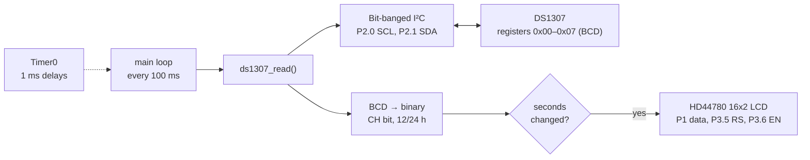

# DS1307 Real-Time Clock on 8051

Embedded C firmware for an 8051 microcontroller (AT89S52 or similar) that keeps time with a Maxim DS1307 real-time clock over I²C and shows the time, date and day on a 16x2 LCD. The 8051 has no I²C hardware, so the I²C master is bit-banged on two port pins, and the DS1307 is driven at register level.

```
TIME 14:30:05 MON
DATE 16/11/2026
```

## Features

- **Bit-banged I²C master:** START, repeated START, STOP, byte write with ACK check, and byte read with ACK/NACK, using the 8051's quasi-bidirectional port pins as open-drain lines.
- **DS1307 driver:** burst-reads all seven time registers in one transaction so the values are consistent, converts BCD, and handles the clock-halt bit and 12-hour mode.
- **HD44780 LCD driver:** 8-bit interface with the datasheet's power-up sequence.
- **Accurate delays:** Timer0 in 16-bit mode, with the reload value calculated from the crystal frequency.
- **Fault handling:** the LCD shows "RTC not found" if the chip doesn't ACK, and "Clock halted" if the oscillator isn't running.
- **Host-tested:** the DS1307 driver is tested on a PC against a mock I²C bus (20 checks), including round-trip set/read, the clock-halt bit, 12-hour conversion and a missing chip.

## How it works



One read transaction:

```
START | 0xD0 (write) | 0x00 (pointer = seconds) | repeated START | 0xD1 (read) | 7 bytes, ACK ... NACK | STOP
```

## Hardware

| Signal | 8051 pin | Connects to |
|---|---|---|
| SCL | P2.0 | DS1307 SCL |
| SDA | P2.1 | DS1307 SDA |
| LCD D0–D7 | P1.0–P1.7 | LCD D0–D7 |
| LCD RS | P3.5 | LCD RS |
| LCD EN | P3.6 | LCD E |
| — | GND | LCD R/W (write-only) |

- **Pull-ups:** SDA and SCL need pull-ups, around 4.7 kΩ to 5 V. Most DS1307 modules already have them.
- **Backup battery:** fit a CR2032 on the DS1307, or the time is lost at power-off. Without it, VBAT must be tied to GND.
- **Clock:** an 11.0592 MHz crystal is assumed. For a different crystal, change `FOSC` in `src/delay.h`.
- **Pins:** to use different pins, edit the `sbit` lines at the top of `src/i2c.c` and `src/lcd.c`.

## Building and flashing (Keil µVision, C51)

1. Create a new µVision project for your 8051 variant (e.g. Atmel AT89S52).
2. Add all files in `src/`, and enable **Create HEX File** under Options for Target → Output.
3. Build and flash the `.hex` file with your programmer.

### Setting the time

1. In `src/main.c`, set `SET_TIME` to `1` and fill in the current time and date.
2. Build and flash. The clock is set at start-up.
3. Set `SET_TIME` back to `0`, then build and flash again. Otherwise every reset sets the clock back to the same time.

## Testing on a PC

```bash
make test       # DS1307 driver against a mock I2C bus
make test-san   # the same tests under AddressSanitizer + UBSan
```

## Project layout

```
src/
  main.c       display loop, error screens, one-time clock setting
  ds1307.c/.h  DS1307 register map, BCD conversion, read/set
  i2c.c/.h     bit-banged I2C master
  lcd.c/.h     HD44780 16x2 LCD, 8-bit mode
  delay.c/.h   Timer0 millisecond delay
test/
  test_ds1307.c  host-side tests with a mock DS1307
```
